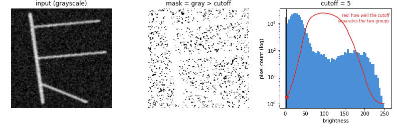

# 1. Loading and binarizing

**Files**: `src/crackgraph/io_utils.py` (17 lines), `src/crackgraph/binarize.py` (26 lines)

These two short files turn a `.jpg` into a black-and-white **mask**: a grid where every pixel
is either crack (`True`) or not crack (`False`). Everything else in the project starts from
that mask.

---

## `io_utils.py`: open the image

### `load_image(path)`, line 9

| Line | Code | What it means |
|---|---|---|
| 9 | `def load_image(path: str \| Path) -> tuple[np.ndarray, np.ndarray]:` | Takes a file path and returns **two** pixel grids. The parts after `:` and `->` are type hints: notes on what goes in and out, not enforced. |
| 14 | `with Image.open(path) as im:` | Opens the file with Pillow (PIL). `with` closes it automatically afterwards. |
| 15 | `rgb = np.asarray(im.convert("RGB"), dtype=np.uint8)` | A **colour** copy: red/green/blue per pixel, whole numbers 0–255. Shape: height × width × 3. |
| 16 | `gray = np.asarray(im.convert("L"), dtype=np.float64)` | A **grayscale** copy: one brightness per pixel, 0 = black, 255 = white, stored as decimals for the maths later. Shape: height × width. |
| 17 | `return gray, rgb` | Returns both. |

- `gray` is what the analysis uses.
- `rgb` is only for drawing results on top of the original photo.
- `"L"` mode weights green most (`0.299·R + 0.587·G + 0.114·B`). Your micrographs are nearly grey
  already, so this barely matters.

---

## `binarize.py`: crack or not crack?

**One threshold for the whole image.** Images are already high-contrast: bright cracks on a dark background. 
We assume no uneven lighting, so one brightness cutoff for the whole image works. `scripts/validation/segmentation_sensitivity_sweep.py` measures how much the results change if this threshold moves.

### `BinarizeResult`, line 13: what this step returns

| Field | Meaning |
|---|---|
| `mask` | The black-and-white grid. `True` = crack. |
| `threshold` | The brightness cutoff chosen, 0–255. `[measured]` |
| `foreground_fraction` | Share of the image marked crack. 0.08 = 8%. `[measured]` |

### `binarize(gray)`, line 19

| Line | Code | What it means |
|---|---|---|
| 19 | function header | Takes the grayscale grid. |
| 20 | `t = threshold_otsu(gray)` | **The key line.** Otsu's method looks at the histogram of all brightnesses and picks the cutoff that best splits them into two groups (dark background, bright cracks), each as uniform as possible inside itself. Fully automatic. |
| 21 | `mask = gray > t` | Brighter than the cutoff = crack. Runs over all ~55 million pixels at once. |
| 22–26 | `return BinarizeResult(...)` | Packs everything up. `foreground_fraction` is `mask.mean()`: the average of True/False values is the share of True. |

**What Otsu is doing**

The example animation tries every cutoff on a blurry, noisy test image. Grey bars are pixels below the
cutoff (background), blue bars are above it (crack). The red curve scores how cleanly each cutoff
separates the two groups: high when both groups are tight and far apart. Otsu's method simply
picks the top of that curve. Notice the curve is flat near the top: cutoffs a few steps either
side give almost the same mask, which is why the result isn't very sensitive to the exact value.

**Worth knowing**

- **Cracks must be the bright part.** Line 21 assumes this. Dark-crack images would come out
  inverted.
- **No cleanup happens here.** Filling bright spots and removing dark specks happens at the start of
  `skeleton.py`.

**Tests**: binarize has no dedicated test file. Every pipeline test runs through it, though.
