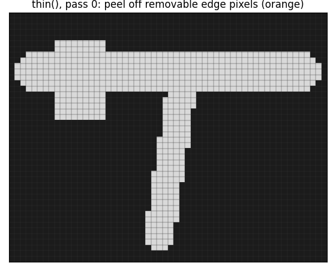
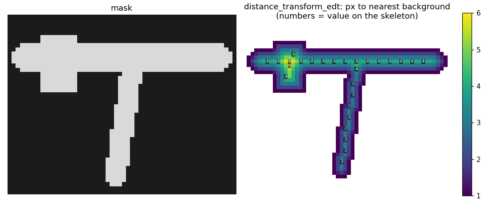
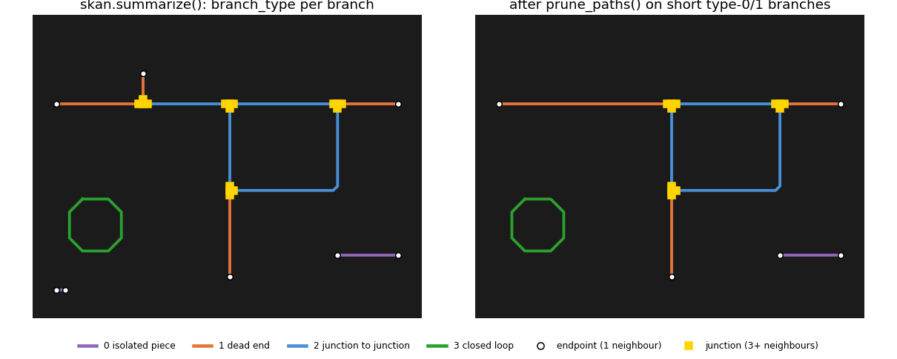
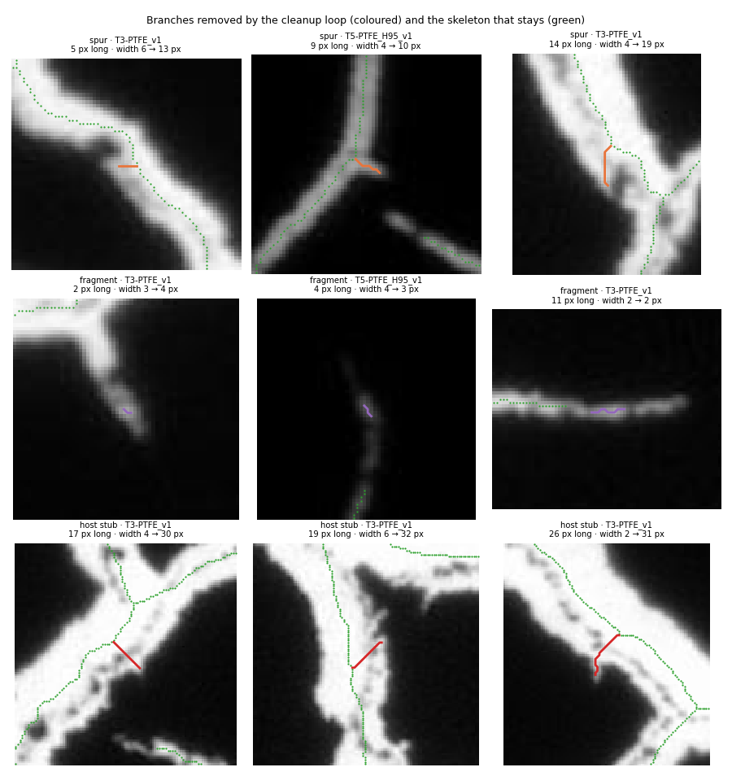

# 2. Skeletonizing

**File**: `src/crackgraph/skeleton.py` (~225 lines)

**What it does.** It thins every crack in the mask down to a line **1 pixel wide** running along
its middle, called the **skeleton**, then removes junk branches the thinning creates.

**Why.** Thick blobs can't be measured as a network. On 1-pixel lines, a crack's length is the
number of pixels it covers, and a junction is wherever 3 or more lines meet.

**The hard part is the cleanup.** Most of this file decides which branches are fake.

### What the library steps do

**Thinning** (`skeletonize`, scikit-image).

Each pass removes the edge pixels (orange) that can go without breaking a line or opening a hole,
like peeling an onion, until only a centre line 1 pixel wide is left (green).

`skeletonize()` doesn't show its intermediate passes, so the animation uses scikit-image's
`thin()`, a close relative, and then shows both finished results. They differ at the square
bulge on the left. `thin()` leaves no side branch there. `skeletonize()`, which the pipeline
uses, leaves two short stubs (circled, 2 and 4 px). Bumps on a crack wall turn into short dead
ends like these, and the pruning below removes them. (COMPARE LATER)

**Width map** (`distance_transform_edt`, SciPy).

Every crack pixel gets its distance to the nearest background pixel. On the centre line that
distance is about half the crack's width, so crack width ≈ 2 × value − 1. The bulge reads 6, the
horizontal crack 4 and the tapering stem 2–3.

**Branch types and pruning** (`skan.summarize`, `prune_paths`).

skan splits the skeleton into branches at the junctions and labels each one with a type. The
cleanup loop below removes only short type 0 and type 1 branches: here the short spur at the top
left and the tiny speck at the bottom left. Removing the spur also removes its junction, so the
two orange and blue pieces on the left merge into one longer dead end. That's why the loop runs
again after each removal. Note that the closed cell on the right counts as type 2, not 3: it is
made of junction-to-junction branches. Only a ring with no junction at all is type 3.

---

## Opening description, lines 1–15

A short summary of the above, plus the main known limitation. The pruning below never removes
**small loops** around dark specks inside wide cracks (thinning can't create a loop without a hole
in the mask, so these come from specks too big for the fill), or **short edges** between junctions
that sit close together. The full reasoning (measurements, rejected methods,
references) lives in [`docs/design_notes.md`](../design_notes.md).

## Settings, lines 26–35

| Line | Setting | Value | Meaning |
|---|---|---|---|
| 29 | `SPUR_PX_PLACEHOLDER` | 15 px = 9.1 µm | Dead ends and loose pieces shorter than this are removed, and dead ends need at least this much length outside their host crack. 🟢 About the largest measured agglomerate size and the typical film thickness, so shorter branches can't be told from wall roughness. See `docs/calibration_notes.md`. |
| 35 | `DARK_SPECK_AREA_PX2` | 130 px² = 48 µm² | Dark specks inside a crack smaller than this are filled first, so the skeleton doesn't loop around them. 🟢 The area of a d90 ≈ 7.8 µm agglomerate (inks T2–T4). |

Both are in pixels for `mm` images (0.6098 µm/px); other magnifications would need converting.

## Result containers, lines 38–66

- **`PrunedBranchRecord`** (line 39): one removed branch. It stores *why* it was removed
  (`"spur"`, `"fragment"` or `"host_stub"`), its length and its exact pixel path, so you can
  later draw what was cut.
- **`SkeletonResult`** (line 51): everything this step produces. The fields that matter most:
  - `skeleton`: the cleaned skeleton as a skan network. The next step uses this.
  - `mask_clean`: the crack mask after bright specks are removed and dark specks filled. Crack
    area is counted from this.
  - `medial_radius`: the **width map**. For every crack pixel, its distance to the nearest crack
    edge, which is half the local crack width. Every width number in the project comes from
    this.
  - The rest are counts and lengths of what was removed, for reporting.

---

## `_length_outside_host(...)`, line 70

**The idea.** Thinning sends a short branch from a crack's centre line into every bump or corner
on its wall, even where no new crack starts. Such a branch never leaves the crack it starts in. A
real side crack does leave it. So this helper measures **how much of a dead end lies outside the
crack it branches from** (its host).

| Line | Code | What it means |
|---|---|---|
| 86 | `j = node_id_dst if ... >= 3 else node_id_src` | Which end of the dead end is the junction (3+ branches meet there). |
| 88 | `r_blob = ...` | The width map at the junction pixel: the radius of the blob where the cracks meet. |
| 90–98 | loop over the junction's other branches | These are the host. Collect their pixels, and the width map along them **1–3 blob radii out from the junction**, so the extra-wide blob doesn't count. |
| 101 | `r_host = float(np.median(widths))` | The host crack's half-width near the junction. |
| 103 | `d_host = cKDTree(...).query(coords)[0]` | For every pixel of the dead end, its distance to the nearest host centre-line pixel. `cKDTree` is SciPy's fast nearest-neighbour lookup. |
| 105 | `steps[d_host[1:] > r_host].sum()` | Add up the path length of the pixels farther than `r_host` from the host centre line: the part **outside** the host. |

Measuring length outside the host, rather than how far the tip gets, also keeps **hooks**: real
cracks that curl round and run alongside their host just past its wall. They never get far from
the host, but most of their length is outside it.

## `skeletonize_and_prune(mask, ...)`, line 108: the main function

**Preparation**

| Line | Code | What it means |
|---|---|---|
| 117 | `remove_small_objects(mask, min_size=min_object_px)` | Delete bright specks under 4 pixels. |
| 118 | `remove_small_holes(..., area_threshold=DARK_SPECK_AREA_PX2)` | Fill dark specks under 130 px² inside cracks. |
| 119 | `skel_image = skeletonize(mask_clean)` | **The thinning.** Zhang–Suen, via scikit-image. |
| 127 | `medial_radius = distance_transform_edt(mask_clean)` | The width map. On a full image this takes about 13 seconds, the slowest single step. |
| 129 | `skel = skan.Skeleton(skel_image, source_image=source_image)` | Hand the skeleton to skan, which turns pixels into branches and junctions. |

**The cleanup loop, line 137.** It repeats up to 10 times and stops early when a round removes
nothing.

| Line | Code | What it means |
|---|---|---|
| 138 | `summary = skan.summarize(skel, separator="_")` | A table with one row per branch: length (`branch_distance`) and **type**. Type 0 = isolated piece, 1 = dead end, 2 = junction to junction, 3 = closed loop. |
| 141 | `is_spur = (type == 1) & (length < spur_px)` | Short dead ends. |
| 142 | `is_fragment = (type == 0) & (length < spur_px)` | Short isolated pieces. |
| 149–163 | host-stub check | For dead ends that *weren't* already too short, measure their length outside the host (above). Less than `spur_px` → a **host stub**, removed. `incidence` (lines 151–154) lists which branches touch each junction, so the helper can find the host. |
| 165–166 | `if ... == 0: break` | Nothing flagged → done. |
| 167–186 | record | Save each flagged branch's length and pixel path *before* removing it, because skan renumbers branches after every removal. |
| 189 | `skel = skel.prune_paths(...)` | **Remove all flagged branches.** skan returns a fresh, cleaned skeleton. |

**Why repeat?** Removing one branch can turn a junction into a plain bend, which can make a
neighbouring branch into a new short dead end. The next round catches it.

Spurs and host stubs are one rule: a dead end needs at least `spur_px` outside its host. A dead
end shorter than `spur_px` can't have that much outside, so it's caught by the cheaper length
check first and reported as a spur.

**Return, line 194.** Packs everything into `SkeletonResult`.

### What gets removed on real images

Three examples of each removal reason, from 2048 × 2048 px centre crops of three micrographs,
chosen at the 25th, 50th and 95th length percentile of their group. "Width" is the crack width at
the branch's loose end → at its other end.

- **Spurs** (top row, orange): short dead ends. Most are stubs from the centre line to a bump or
  corner on the crack wall. Some are the start of a real faint side crack whose rest fell below
  the Otsu cutoff.
- **Fragments** (middle row, purple): short isolated pieces. These are mostly bits of real faint
  cracks that thresholding broke into dashes, not noise.
- **Host stubs** (bottom row, red): longer than 15 px, so the length rule misses them, but they
  run from a wide crack's centre line to its wall and stop there (width 4 → 30 px up to
  2 → 31 px from tip to junction).

**The numbers** (same three crops, `spur_px` = 15):

| Image | Spurs | Fragments | Host stubs | Skeleton length removed |
|---|---|---|---|---|
| T3-PTFE_v1 (dense, wide cracks) | 160 | 44 | 85 | 7.0% |
| T4-M_H95_v1 (dense, membrane) | 66 | 6 | 49 | 3.2% |
| T5-PTFE_H95_v1 (sparse, thin cracks) | 39 | 130 | 7 | 7.8% |

| Reason | Count | Median length | Range |
|---|---|---|---|
| Spur | 265 | 9 px | 1–15 px |
| Fragment | 180 | 4 px | 1–15 px |
| Host stub | 141 | 19 px | 15–34 px |

For host stubs, the width at the junction end is a median 7.1× the width at the tip.

**What this means for the statistics.** On wide-crack images, most of what gets removed is
spurs and host stubs, which are artifacts. On thin-crack images such as T5-PTFE_H95, most is
fragments of real faint cracks. Removing them lowers total crack length and the component count
`N`, because each fragment would otherwise count as its own component. So fragment pruning is a
choice about what counts as a crack, not just cleanup.

The host-stub rule replaced an earlier correlation test (width rising steadily along the branch,
correlation > 0.99), which missed many stubs just under 0.99 and removed some real cracks cut off
by the image edge. Removing the extra stubs raises the median edge length `ledge` by up to about
20% on dense wide-crack images. See `CHANGELOG.md`.

These figures and numbers come from `scripts/docs/make_walkthrough_figures.py`. They skip the
flaking exclusion that the batch export applies, so they won't match the export exactly.

---

## Worth knowing

- **Only types 0 and 1 are ever removed.** Junction-to-junction branches (type 2) and loops
  (type 3) are never touched. `scripts/validation/skeleton_loop_sweep.py` finds 0–55% of edges
  per image are junction-to-junction edges shorter than the crack width. Only about 8% of those
  sit next to a dark speck (a real small loop); the rest are short segments between close
  junctions. See `docs/design_notes.md`.
- **Everything is in pixels.** Converting to µm happens in the exporter.
- **Tests**: `tests/test_skeleton.py` (7 tests):
  - a stub from a wide crack's centre line into a small bump on its wall is removed (and kept
    with the rule off); a real side crack, a long tapering wedge and a plain line are kept
  - small dark specks are filled and large dark regions aren't

  Many other test files use `spur_px=3` instead of 15, so the default value itself isn't
  validated by tests; its justification is physical (see Settings).
